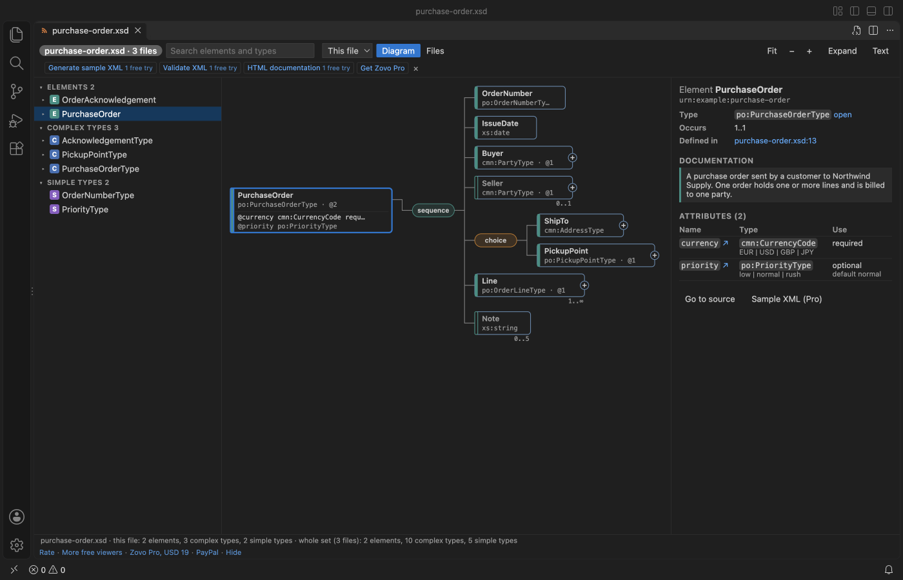

# XSD Viewer & Schema Diagram

Read XML Schema (.xsd) files and the schemas inside .wsdl files as a component tree and a diagram in a VS Code tab, with imports and includes followed across your workspace. Works offline. Made by Zovo.

Free, with no account and no network calls:

- A tree of the global elements, complex types, simple types, model groups, attribute groups and attributes, for the opened file or for every file of the schema set. Open a row to see its content: sequences, choices, child elements with their occurs and types, and attributes.
- A diagram drawn from left to right: a box for each element with its name, type and attribute count, a pill for each sequence, choice or all, and the min and max occurs under each box. The + on a box opens its content, also when the type is defined in another file.
- Details of the picked node: type, occurs, default and fixed values, substitution groups, derived types, documentation, restrictions (enumerations, patterns, lengths, number ranges, digits), lists, unions and attributes.
- xs:include, xs:import, xs:redefine and xs:override are followed on local files, chameleon includes too. A schemaLocation that is a web address is never downloaded: the viewer uses the workspace file with that target namespace instead, and the Files tab lists anything it could not find.
- Search by name in every file of the schema set. Double-click a box or a tree row to open the schema text at that line, next to the viewer.
- The schemas inside .wsdl files (WSDL 1.1 and 2.0) show the same way. The viewer redraws when the schema text or a file of the set changes.

Zovo Pro: USD 19 once, for the Pro tools in every Zovo extension. Each Pro tool has 1 free try on your computer first:

- Generate sample XML: pick a global element and get a sample document with all required content. Optional elements and attributes, two copies of repeating elements and comments at choices are options. Values keep enumerations, patterns, lengths and number ranges.
- Validate XML: check an XML file against its schema set with libxml2 2.13.8, compiled to WebAssembly and run inside VS Code. No Java, no network. Errors and their line numbers go to the Problems panel. With Zovo Pro the file is checked again on every save.
- HTML documentation: a folder of plain HTML pages for the schema set, with an index of files, imports and components. Each element and type gets a page with its diagram, content, attributes, values, documentation and the components that use it.

## How to use it

- Schemas keep opening as text. To open one in the viewer, click the diagram button in the title bar of the schema's editor, right-click the file in the Explorer and choose Open in XSD Viewer, or run XSD Viewer: Open in XSD Viewer. To make the viewer the default for .xsd files, use Reopen Editor With and then Configure default editor.
- Pick a component in the tree to draw its diagram. Click the + on a box to open it, Expand to open up to 60 visible boxes one level further, and Fit, + and - to zoom. Type in the search box (or press /) to find any element or type in the set, then Enter to open the first match.
- Text in the toolbar opens the schema next to the viewer. The Files tab shows each file of the set, its namespace and where each import and include was found.
- To try it without a schema of your own, run XSD Viewer: Open the Sample Schema. It comes with a valid order and an order with three mistakes for the validation.
- The Pro tools are in the Command Palette (XSD Viewer: ... (Pro)), in the Explorer right-click menu (sample XML and documentation on .xsd and .wsdl files, validation on .xml files), as Sample XML (Pro) in the details of an element, and in the small row at the end of the viewer toolbar. The row closes with its x for the rest of the session, and the setting `xsdViewer.showProTools` hides it for good.

## How the validation finds the schema

1. `xsi:schemaLocation` or `xsi:noNamespaceSchemaLocation` in the XML file. A web address there is not downloaded; the workspace file with that namespace is used.
2. The schema you started from (the open viewer, or the schema's text editor).
3. A workspace schema whose target namespace is the namespace of the root element. If there are several, you pick one.

libxml2 checks XML Schema 1.0. It reports line numbers, not columns, so each problem marks its whole line.

## Tested with

The OASIS UBL 2.1 schemas (Invoice, Order and Credit Note with their 14 shared files, 1,621 global elements), an ISO 20022 payment message schema (pain.001.001.11), the W3C schema for schemas (XMLSchema.xsd with xml.xsd), a WSDL from the Apache CXF samples, and the sample purchase order. Samples made by Generate sample XML with its default options validate against each of these schemas with libxml2.

## Settings

- `xsdViewer.validateOnSave`: with Zovo Pro, check validated XML files again when they (or a schema of their set) are saved.
- `xsdViewer.sampleMaxDepth`: how deep optional elements go in a sample (default 8). Required elements always go in.
- `xsdViewer.showProTools`, `xsdViewer.askForRating`, `xsdViewer.showSupportLinks`.

## Limits

- Sample XML does not know identity constraints (xs:key, xs:unique), so two copies of a repeated element can share a key value. A type that contains itself stops after one level, and optional elements stop after 5,000 elements in one sample.
- The diagram and the sample generator read XML Schema 1.0. XSD 1.1 assertions and conditional types are not drawn.
- HTML documentation for a very large set is large: for UBL 2.1 it is 2,844 pages and about 20 MB.

## Privacy

Nothing leaves your computer. The viewer has no network access (its content security policy blocks every remote load), the extension makes no network calls of its own, and there is no telemetry. Validation runs in a worker thread inside VS Code.

## Made by Zovo

XSD Viewer & Schema Diagram is made by Zovo. XML parsing uses @xmldom/xmldom (MIT) and validation uses libxml2 through xmllint-wasm (MIT); see THIRD-PARTY-NOTICES.md.
